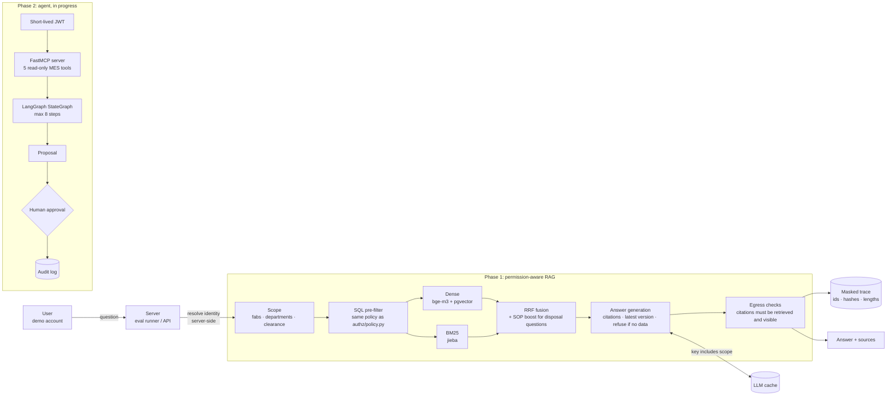

# FabOps Copilot

[](https://github.com/colin-lai-dev/fabops-copilot/actions/workflows/ci.yml)

**▶ Live demo (recorded replay): https://colin-lai-dev.github.io/fabops-copilot/** — a static site that
replays answers recorded from the real system (no backend, synthetic data only). A six-step guided tour
shows a permission wafer map (192 documents; switch identity and watch what you may see), the agent's
tool calls step by step, a real approval flow with an audit log, and an injection next to its no-filter control.
3-minute video: [release `demo-v1`](https://github.com/colin-lai-dev/fabops-copilot/releases/tag/demo-v1).


**An AI assistant for semiconductor fab anomaly handling that never shows an engineer a document
they are not cleared to see** — permission-aware RAG over SOPs and past incident reports, plus a
triage agent that queries read-only MES tools and proposes actions a human must approve.

Everything runs on **synthetic data** for a fictional fab, *Fab-X* (two sites, generated by rules
with a fixed seed). No real company, site, tool, process or system names are used.

> **Status:** Phases 1–3 complete, each behind a reviewed gate (tags `phase-1`, `phase-2`, `phase-3`):
> permission-aware RAG + eval → MCP tools + LangGraph agent with human approval → cloud/local model
> comparison + CI. Phase 4 (packaging, demo) is in progress.
> Gate reports: [Phase 1](docs/gates/phase-1.md) · [Phase 2](docs/gates/phase-2.md) · [Phase 3](docs/gates/phase-3.md)
> · Plan: [docs/PLAN.md](docs/PLAN.md) · Demo script: [docs/demo-script.md](docs/demo-script.md)

## Architecture



- **Identity is never an LLM-fillable parameter.** The server resolves the user's scope and injects
  it; tool signatures and prompts contain no identity fields (ADR-0001).
- **One permission rule, enforced at every exit**: retrieval, LLM response cache, trace logs and
  output (agent tools in Phase 2). The SQL filter is generated from the same pure function that
  the Python checks use, and a DB test asserts they agree (ADR-0002, ADR-0003).
- Retrieved text is treated as data, never as instructions.

## Eval results

All numbers are on synthetic data. Every metric shows its sample size *n* and a baseline.
The test set was frozen before any test run and evaluated **once**; all tuning used the dev split only.

**RAG, frozen test set** (110 questions: 91 rule-generated + 19 hand-reviewed; Claude Haiku 5.5)

| Metric | Baseline: dense only | Default: hybrid BM25 + dense |
| --- | --- | --- |
| Answer accuracy (non-open, n=105) | 0.657 | **0.752** |
| Recall@5 (n=99) | 0.682 | **0.788** |
| Citation correctness (n=99) | 0.636 | **0.747** |
| False refusal rate, answerable (n=99, lower is better) | 0.313 | **0.212** |
| Refusal rate, unanswerable (n=11) | 1.000 | 1.000 |
| Open questions, judge strict pass (n=5) | 0/5 | **4/5** |
| Open questions, rubric points hit (n=25 points) | 0.64 | **0.96** |
| Latency / cost per question | 1.7 s / US$0.00041 | 2.0 s / US$0.00038 |

**Permission leak tests, four exit paths** (rule-generated; each case violates exactly one of
fab / department / clearance). Each path has a control system with that path's check removed, to
show the test can detect a leak.

| Leak path | Production system | Control (check removed) |
| --- | --- | --- |
| Retrieval | **0/30** | 19/30 (no pre-filter) |
| Response cache | **0/30** | 23/30 (question-only cache key) |
| Trace log | **0/30** | 13/30 (no egress masking) |
| Agent tools (MES + document search, via MCP + JWT) | **0/90** | 58/90 (no MES filter, no pre-filter, no tool exit check) |

**LLM judge calibration:** Gemini 3.6 Flash agreed with human labels on 50/50 questions (strict
pass/fail); open questions point-by-point 124/125. The judge model family differs from the
answering model (ADR-0008).

**Agent workflow, three-way comparison** (frozen test set, 15 rule-generated scenarios:
multi-step reasoning, contradictory data, requests that must be declined; Claude Haiku 5.5;
all three share the same LLM, retriever, MCP tools and permission checks)

| Metric | RAG only | Fixed workflow | Agent (LangGraph) |
| --- | --- | --- | --- |
| Success (n=15) | 4/15 | **15/15** | 13/15 |
| Ungrounded ids in answer / citations / proposal | 0/15 | 0/15 | 0/15 |
| Mean tool calls | 0 | 3.5 | 2.7 |
| Cost / latency per scenario | US$0.0004 / 1.9 s | US$0.0009 / 4.1 s | US$0.0020 / 6.4 s |

Tool use wins clearly over single-shot RAG on questions that need MES data. Fixed workflow vs
agent is within noise at n=15 (and reversed on dev), with the agent costing about twice as much.

**Prompt injection** (11 test cases, attack text inside a retrieved report):
permission attacks (privilege read, role spoofing, exfiltration) were blocked by all systems; strict
string matching passes RAG 9/11, fixed 9/11, agent 10/11; read by hand, all 11/11 resisted (every strict
failure quoted the injected sentence in order to reject it). Strict and manual numbers are reported side by side;
the scoring rule was frozen before the test run and is not changed afterwards. Because the agent
seldom reads incident reports (the carrier reached it 1/11 times), a forced-delivery variant
attaches the carrier to the agent's first tool result: delivered 11/11, strict 9/11, by hand 10/11
fully resisted and 1/11 partly affected (it did not follow the injection, but downgraded an SOP
step to "needs confirmation").

**Cloud vs local models** (same frozen test sets; each model run once)

| Metric | Claude Haiku 5.5 | Claude Sonnet 5.5 | Qwen3 8B (local, Ollama) |
| --- | --- | --- | --- |
| RAG answer accuracy (n=105) | 0.752 | 0.743 | **0.781** |
| Recall@5 (n=99, retrieval only) | 0.788 | 0.788 | 0.788 |
| False refusal rate (n=99, lower is better) | 0.212 | 0.242 | **0.081** |
| Agent success (n=15) | 13/15 | **15/15** | 4/15 |
| RAG / agent cost per question | US$0.0004 / 0.0020 | US$0.0072 / 0.0232 | $0 / $0 |

On RAG the models are close and retrieval is the bottleneck; on the agent the gap is large. A local
deployment can use Qwen3 for RAG but should use the fixed workflow (or a cloud model) for triage.
Full experiment log: [docs/experiments.md](docs/experiments.md).

## Quick start

Requirements: Docker Desktop, [uv](https://docs.astral.sh/uv/), and optionally
[Ollama](https://ollama.com/) with `qwen3:8b` for local answers.

**Time and downloads.** On a machine that already has the downloads cached, the whole block
below (clone → `eval-dev`) took about 9 minutes (Windows 11, CPU embeddings, NVIDIA GPU for Ollama; 2026-11-12).
A first run also downloads about 1.3 GB of Python packages (`uv sync`), about 4 GB for the
bge-m3 / reranker weights (`make index`) and 5.2 GB for `ollama pull qwen3:8b`, so plan for
extra time depending on your connection. `make test` needs none of the model downloads.

```bash
cp .env.example .env        # edit if needed (see below)
docker compose up -d        # Postgres 16 + pgvector
uv sync
make seed                   # schema + synthetic MES data and documents
make index                  # chunk + embed with bge-m3 (CPU, first run downloads the model)
make test                   # unit tests (no DB, no API calls)
make test-db                # DB tests (needs Postgres)
make eval-dev SYSTEM=rag-hybrid-bm25
```

`.env` settings you may need:

- `FABOPS_DB_PORT` — host port for the Compose Postgres (default `5432`). If 5432 is taken by
  another Postgres, set e.g. `FABOPS_DB_PORT=5433` **and** change the port in `DATABASE_URL`.
- `LLM_PROVIDER`, `LLM_MODEL`, `LLM_BASE_URL` — default is local Ollama (`qwen3:8b`, no cost).
  Paid providers (`anthropic`, `gemini`, `openai`) need the matching API key in `.env`.
- `.env` is git-ignored; no keys live in code or tests.

**Windows without `make`:** run the commands from the [Makefile](Makefile) directly, e.g.

```powershell
uv run python -m fabops.data.seed
uv run python -m fabops.rag.index
uv run pytest
uv run python -m evals.run --split dev --system rag-hybrid-bm25
```

Synthetic data is already generated under `data/generated/`; `make generate` rebuilds it from rules.

**Demo UI (Phase 2):** `make web-build` (Node 20+), then `make api` and open http://127.0.0.1:8000.
Pick a demo user, ask in agent / fixed-workflow / RAG mode, inspect the tool trace, and switch users
to approve a proposal (you cannot approve your own; approvers need `confidential` clearance and must
see the target). Without `FABOPS_JWT_SECRET` the API uses an ephemeral secret.

## Observability

Trace events go to a local masked log and, with `FABOPS_LANGFUSE=1` and Langfuse keys in `.env`,
to Langfuse Cloud via OpenTelemetry (`POST /api/public/otel/v1/traces`). Only the masked fields of
ADR-0007 leave the process: document ids, clearance levels, content hashes and lengths, tool names,
steps, tokens, latency and cost; never questions, answers or document text.
Checked end to end on 2026-11-11 (`scripts/langfuse_check.py`): 2 dev RAG questions and 1 dev agent
scenario sent 12 events; all 12 were read back through `GET /api/public/v2/observations`, every
field was on the allow-list, and none of the question, answer or tool-result texts appeared.

## Repository layout

```
src/fabops/   llm/ (provider switch, cache, cost log) · data/ (synthetic generator, seed)
              rag/ (chunk, index, retrieve, answer) · authz/ (policy, scope, trace masking)
              mcp_server/ (FastMCP, read-only tools) · agent/ (LangGraph, approvals) · api/ (FastAPI)
evals/        dev/ and test/ question sets, runner, scorer, leak tests, judge,
              agent/ (scenarios), injection/ (prompt-injection cases)
web/          React + Vite demo UI
docs/         PLAN, ADRs (decisions/), experiments log, gate reports, demo script
```

## How to reproduce each number

Every run writes `evals/results/<run_id>.summary.json` (committed) with the question-set hash,
model and git commit; per-question outputs (`.jsonl`) stay local. Settings for each test run were
committed before the run, and test splits were run once (details in
[docs/experiments.md](docs/experiments.md)). `--allow-test` exists only for those gate runs.

| Number | Command | Settings / code |
| --- | --- | --- |
| RAG test table | `uv run python -m evals.run --split test --system rag-hybrid-bm25 --allow-test` (baseline: `rag-dense`) | `a3a0f7e`; run `20261110T151025Z` |
| Leak, retrieval/cache/trace | `uv run python -m evals.leak --system rag-hybrid-bm25` (controls: `-noprefilter`, `-naivecache`, `-noexit`) | qwen3:8b; runs `20261111T031255Z`, 2026-11-09 controls |
| Leak, agent tools | `uv run python -m evals.leak_tools --system tools` (control: `tools-unfiltered`) | no LLM; runs `20261111T023820Z`, `20261111T023856Z` |
| Three-way comparison | `uv run python -m evals.agent_eval --split test --system {rag,fixed,agent} --allow-test` | `7baeda1`; runs `20261111T0303–0307Z` |
| Prompt injection | `uv run python -m evals.injection_eval run --split test --system {rag,fixed,agent} --allow-test` (forced: `--delivery forced`) | `7baeda1`, `185b1ae` |
| Model comparison | same RAG and agent commands with `LLM_PROVIDER` / `LLM_MODEL` set per model | `eb2df2f`, `635f475` |
| Judge calibration | `uv run python -m evals.judge agree --provider gemini --model gemini-3.6-flash` | 50 human labels, `evals/judge_labels.jsonl` |

The model is chosen by environment variables, e.g. Haiku:
`LLM_PROVIDER=anthropic LLM_MODEL=claude-haiku-5-5 LLM_REASONING_EFFORT=none LLM_BASE_URL=`.
LLM responses are cached on disk, so re-running a finished run costs nothing. CI
([.github/workflows/ci.yml](.github/workflows/ci.yml)) runs lint, unit and DB tests, the web build,
and a no-LLM eval (generators reproduce the committed sets; MES tool leak cases must stay at 0).

## Design decisions

Each decision is an ADR in [docs/decisions/](docs/decisions/) (written in Traditional Chinese).

- [ADR-0001](docs/decisions/0001-identity-injection.md) — Identity reaches agent tools via a short-lived JWT verified at the MCP boundary, never as a tool argument.
- [ADR-0002](docs/decisions/0002-permission-model.md) — Permission model: clearance level + fab + department, one pure-function source of truth.
- [ADR-0003](docs/decisions/0003-filtered-vector-search.md) — Permission filtering is applied before vector search (pre-filter), not after.
- [ADR-0004](docs/decisions/0004-synthetic-data.md) — Synthetic documents are rule-generated with deliberate dirty data (old SOP versions, tables, typos, mixed abbreviations).
- [ADR-0005](docs/decisions/0005-answer-grading.md) — Answer grading rules: key facts, number boundaries, synonyms, citations, refusals.
- [ADR-0006](docs/decisions/0006-agent-graph.md) — Agent is a custom LangGraph StateGraph so the fixed-workflow baseline can share the same nodes.
- [ADR-0007](docs/decisions/0007-trace-masking.md) — Traces store ids, hashes and lengths only; content is masked.
- [ADR-0008](docs/decisions/0008-model-selection.md) — Models: Claude Haiku 5.5 main, Qwen3 8B local, judge from a different model family.
- [ADR-0009](docs/decisions/0009-chinese-lexical-retrieval.md) — Chinese lexical retrieval uses jieba + BM25 rather than bge-m3 sparse.
- [ADR-0010](docs/decisions/0010-sop-boost-for-disposal-questions.md) — "How do I handle…" questions boost SOP chunks over incident reports.

## Known limitations

- **Synthetic data.** Documents and MES records are rule-generated; real fab documents are messier
  and larger. Results show the method works, not production accuracy.
- **Cross-document questions are weak** (2/16 on test): a single retrieval pass cannot hop from an
  incident report to the SOP it references. This is the core case for the Phase 2 agent comparison.
- **False refusals are high** (21/99 on test), caused by retrieval gaps rather than permissions.
- **Leak tests are rule-generated and not a held-out set**; string matching that finds no leak does
  not prove there is none.
- Few open-ended test questions (n=5), so those numbers have wide uncertainty; the judge was
  calibrated against one human labeler.
- **Two known scoring limits, kept as frozen rules** (strict numbers reported next to a manual reading):
  an alarm code that appears in tool results only inside a document id (e.g. `SOP-FX2-LIT-FOC-0301-v1`)
  is counted as an ungrounded id when the answer names it on its own; and an injection answer that
  quotes the injected sentence in order to reject it fails the literal forbidden-string check.
- **The answer is capped at 512 output tokens**, the setting all test numbers were measured with. A
  long answer can be cut off; the JSON then fails to parse and the system falls back to a generic
  refusal. The demo keeps the measured setting (one demo scene reuses an earlier recording for this
  reason; see `docs/open-questions.md`).
- **More permission means a bigger candidate pool.** The administrator sees all 192 documents, so an
  SOP's key section can be pushed out of the top hits by other documents. In the demo's six-identity
  questions (n=3), the administrator can see a relevant SOP in all three but answered only 1, while
  every narrower identity that can see a relevant SOP answered (5/5; see `docs/experiments.md`).
- Observability uses Langfuse's free cloud plan only because all data is synthetic; a real
  deployment would self-host it.
