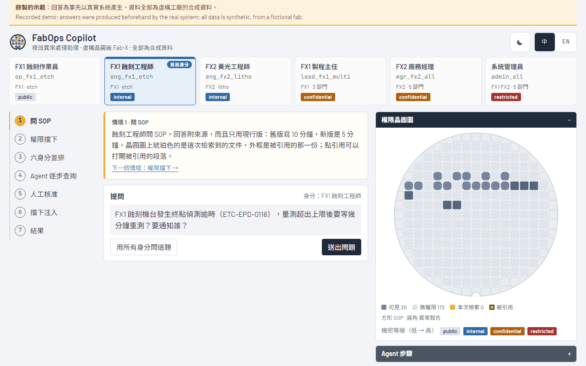
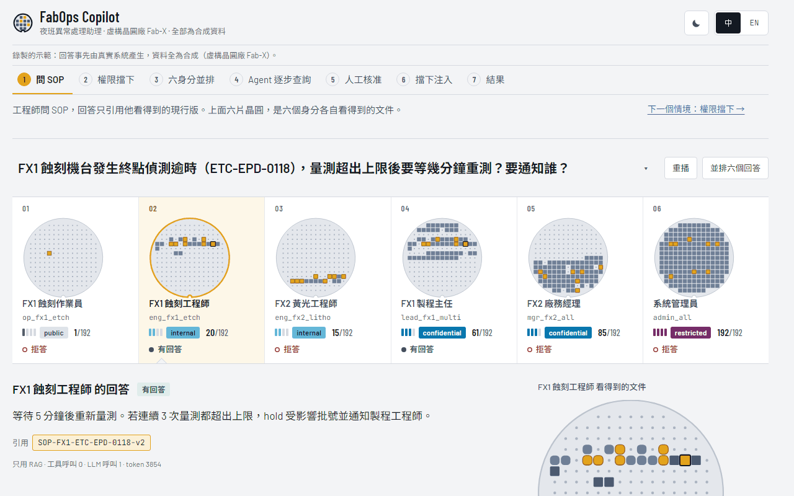
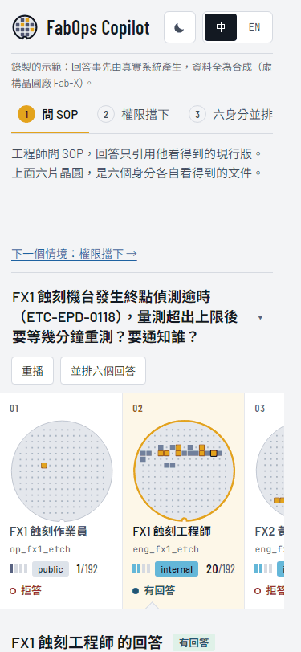

# Design case study: from v8 to v9, how I directed an AI on design and checked the result

[中文](case-study-design-lab.md) · Current site: <https://colin-lai-dev.github.io/fabops-copilot/> · Previous version (v8): <https://colin-lai-dev.github.io/fabops-copilot/v8/>

## 1. Background

In 30 seconds, this demo has to show an interviewer three things:

1. The same question gets different answers under different permissions, and permission is applied before retrieval.
2. The agent looks things up step by step with read-only tools, can only propose an action, needs a qualified person to approve it, and everything is audited.
3. Every answer is a recording from the real system, the data is synthetic, and the numbers can be reproduced.

## 2. Two ways of directing the work

- **v1–v8: one specific request at a time.** Each round I listed concrete changes, for example making clearance levels filled chips (`79d66c9`), removing self-explaining notes (`98c236a`, `b70da04`), and fixing the layout jump when switching language (`e3caca4`). The implementation was done by Claude Opus 5.5.
- **v9: one open design brief.** I wrote only the goals, the red lines and the quality floor (full text in the appendix). Claude Fable 5.2 reviewed the old version itself, proposed three directions, picked one and built it.

The division of work was the same both times: I decided the direction and the trade-offs; one AI model did the implementation; a separate AI session acted as a planning and review assistant, reading each implementation report, checking the screenshots and drafting the next request, and I decided what went out.

## 3. The frame I set

- **The test**: every design decision has to answer "does it make those three things clearer?"
- **Red lines**: recorded data may not be edited by hand; no answer or number that was not recorded; permissions must be shown correctly (a document an identity cannot see shows no attributes); no paid API calls; the front-end bundle may not grow by more than 150 KB.
- **Quality floor**: usable at 1280, 1024 and 375 px; WCAG AA text contrast in light and dark; zero shift of the main blocks when switching identity, step or language (measured by a script); mobile Lighthouse scores of 90 or more.
- **Process**: at least three rounds of "screenshot, name the three weakest points, fix"; in the last round, remove one element that is not needed.
- **Parallel preview**: the new design was deployed under a separate `/lab/` path and the released site was not touched. I decided whether to replace it only after looking.

## 4. Result

The v9 idea in one sentence: **the six identities are six wafers in one lot; shine the same question on them and they light up in different places.**
It merges three v8 components (identity cards, the permission wafer map, the six-identity view) into one row, and switching identity keeps the question.

| v8 first screen (1280) | v9 first screen (1280) | v9 first screen (375) |
| --- | --- | --- |
|  |  |  |

| Item | v8 | v9 | How it was measured |
| --- | --- | --- | --- |
| Lighthouse performance (mobile) | 80 / 89 / 82 | 98 / 97 / 98 | Lighthouse 13.6, 3 runs each on the live URLs (2026-11-13); v8 measured at `/v8/` |
| First contentful paint | 2.1–2.5 s | 1.5–1.8 s | range over the same 3 runs |
| Cumulative layout shift | 0–0.262 | 0–0.043 | range over the same 3 runs |
| CSS size (uncompressed) | 444 KB | 42 KB | bytes of the live file; most of the difference is no longer downloading a CJK web font |
| JS size (uncompressed) | 209 KB | 204 KB | same |
| Permission difference visible without clicking | no (step 3, or a button) | yes (first screen) | see the two first-screen images above |
| Permission display check | — | all 66 views pass | `web/scripts/review-lab.mjs`: 11 questions × 6 identities, checking locked-document counts and cited documents; 3 widths × light and dark |
| Shift of the main blocks on interaction | — | 0 px | `web/scripts/measure-shift.mjs`: 20 interactions × 3 widths |

## 5. Review and overrules

- **Overruled (my decision): the model removed the clearance colours.** So that colour would only mean "retrieved, verdict, agent", the first v9 build turned the four levels into a single-colour meter (`8edcb9c`). I overruled that judgement and asked for colour back, on the condition that it avoids the state colours and still works for colour-blind viewers. The first palette tried put a blue too close to the agent's violet under colour-blindness simulation and was stopped by the check script; the final ramp is grey → sky → blue → plum (`d5a1160`). Smallest colour difference ΔE between a clearance colour and a state colour (CIE76, threshold 20): light theme 44.8 / 27.1 / 26.1, dark 28.9 / 22.1 / 22.9 (normal vision, simulated protanopia, simulated deuteranopia; `web/scripts/palette_check.py`).
- **Caught (found by the review assistant while checking screenshots; I confirmed it and sent it for fixing): the audit log disappeared after approving (v5).** The self-check only verified that the entries had appeared, not that they stayed. The cause: a full-page screenshot, or resizing the window across 760 px, moved the approval block between two columns, which rebuilt it and lost its state. After the fix the self-check has two persistence assertions (`b17209f`).
- **Caught (I found it while using the site): the screen shook when the question picker opened (v9).** The self-check missed it because it only happens in a short window. The cause: the picker called `scrollIntoView` to show the current option, which also scrolled the whole page (74 px at 1280×620, 199 px on a phone). It now scrolls only its own list, and opening, moving through, closing and choosing from the picker are part of the shift measurement (`ebfb2e6`).
- **Caught (found by the review assistant while checking screenshots; I confirmed it and sent it for fixing): uneven spacing in the step list (v6).** To keep language switching at zero shift, each step reserved the height of the taller language, which left gaps under some steps and misaligned their numbers (`e3caca4`). It became a fixed row height with shorter English step names (`b4ddba5`).
- **Adopted, with the old version kept (my decision).** v9 replaced the released site; v8 is built unchanged from its tag into `/v8/`, so the two approaches can be compared side by side (`7d1cbdd`).

## 6. Limits

- This is not a fair comparison of models: v8 never received the same open brief, and the two phases were directed differently, so nothing here says which model is better.
- All data is synthetic (the fictional fab Fab-X).
- Design quality is partly subjective; the measurements above cover only what can be measured.
- Lighthouse scores vary between runs, so the three individual results and ranges are listed instead of one number.

---

## Appendix: the full v9 design brief

This is the brief given to the model, translated from Chinese. Only internal paths and personal information were removed.

> ### Purpose
> The author has frozen `site-v8`; the released site stays at v8. This round is an **experiment**: without the limit of
> "small changes", see how far you can take the design of this demo. Use your best design judgement. The goal is not to
> finish a checklist but to make something people remember. The result goes under a separate `/lab/` path for the author
> to compare; it replaces the released version only if he likes it, otherwise it is thrown away and the released
> version is not affected at all.
>
> ### 0. Version protection and deployment (do this first, do not skip)
> 1. Tag the current main as `site-v8-final` (the same as site-v8, an anchor for going back in one step) and push the tag.
> 2. Develop on the branch `design-lab`. **Do not merge it into main.**
> 3. Change `.github/workflows/pages.yml` (this change itself is merged into main, the only change allowed there):
>    - Build the released site from main into `web/dist` as before.
>    - Also check out the `design-lab` branch (if it exists), build it with base `/fabops-copilot/lab/` into `web/dist/lab/`, and deploy both together.
>    - A push to `design-lab` also triggers a deployment (still built from main + design-lab).
>    - The lab page carries `<meta name="robots" content="noindex">` and a banner saying "design lab" with a link back to the released site.
>    - After deploying, confirm that the released site is identical to v8 and the lab site opens.
> 4. The later decision (the author's, not yours): adopt → merge design-lab into main, tag `site-v9`, remove the lab build; drop → delete the lab build step, and main was never touched.
>
> ### 1. Understand first, then design
> - Read the demo script, the README, the current site's code and the v8 screenshots. If a design skill is available, load it and follow it.
> - As an interviewer seeing the site for the first time, walk through the whole flow at 1280 and 375, light and dark, and take screenshots. Write a design review:
>   what is not understood at first glance, where the visual hierarchy is unclear, what is too flat, what is too full, what looks like a template. At least 10 points, down to the component.
> - In 30 seconds the site must make an interviewer understand three things:
>   1. The same question gets different answers under different permissions (permission is applied before retrieval).
>   2. The agent looks things up step by step with read-only tools, can only propose, needs a qualified person to approve, and everything is audited.
>   3. Every answer is a recording from the real system, the data is synthetic, and the numbers can be reproduced.
>
>   Every design decision must be able to answer "does it make these three things clearer?"
>
> ### 2. Propose directions, pick one and take it all the way
> - Propose 3 clearly different design directions, each with: a one-sentence concept, colours (4–6 named hex values), type and hierarchy, a layout sketch (ASCII is fine),
>   and "the one element of this direction people will remember". Find the directions in the subject itself: a fab, a night-shift MES console, a cleanroom, wafer inspection.
>   Avoid anything that looks like an AI-generated template (cream background with a serif face, black with neon green, the same rounded shadowed card everywhere, a small all-caps label above every heading).
> - Pick one yourself, write down why, then build it fully. Keep the boldness in one place: let one element be the thing people remember, and keep everything else quiet and disciplined.
>
> ### 3. What may and may not change
> **May change a lot**: layout structure, information architecture and reading order, type, the colour system, spacing and grid, component appearance, interaction and animation, the first screen,
> the look of the wafer map, how the six identities are shown side by side, how the agent timeline is shown, empty and error states, wording (shorter, clearer).
>
> **Every feature must remain and work**: the 7 guided scenes, the six-identity view (10 questions), the permission wafer map and its three-phase animation, the citation drawer, the step-by-step agent timeline,
> the three approval outcomes and the audit log, the blocked injection and its control, the result charts, Chinese / English, light / dark, deep links, keyboard operation.
>
> **Must never change** (stop and report if violated):
> - The recorded answers and results (`scenes.json`, `results.json`) may not be edited by hand; no answer, number or fake data that was not recorded.
> - Permissions must be shown correctly: a locked document shows no attributes or text; the drawer shows only passages that identity may see.
> - No real company, site, tool, process or internal system name or trademark.
> - No new backend and no paid API calls. Justify any new front-end dependency; stop and report before the total bundle (fonts excluded) grows by more than 150 KB.
> - Do not read .env, do not force push, do not rewrite history, do not delete data.
>
> ### 4. Quality floor (no need to announce it, but it must hold)
> - Looks good and works at 1280, 1024 and 375; no horizontal scrolling.
> - WCAG AA text contrast in light and dark; clear keyboard focus; `prefers-reduced-motion` respected.
> - Zero shift of the main blocks when switching identity, step or language (use the existing measurement script); the audit log stays after approving (use the existing assertions).
> - Animation: only one carefully choreographed moment may play by itself; every other animation only answers a user action.
> - Lighthouse (mobile) performance, accessibility and best practices all ≥ 90, with the numbers in the report.
>
> ### 5. Self-critique loop (at least three rounds)
> Each round: screenshots → as an interviewer and as a senior designer, pick the three weakest points → fix → screenshots again.
> In the last round "take off one accessory before leaving the house": remove one decoration or element you think is not needed. Keep the screenshots and the points of all three rounds and put them in the report.
>
> ### 6. Deliverables
> - The `design-lab` branch, one commit per meaningful change; the lab site live.
> - Side-by-side screenshots of v8 and the lab for the same screens (first screen, six identities, agent, approval, injection, results; 1280 and 375; light and dark).
> - A report:
>   1. The main points of the design review (what you think v8's biggest problem is).
>   2. The three directions and why you chose one.
>   3. What changed and why (organised by "making the three things clearer", not as a log).
>   4. What you deliberately did **not** do, and why.
>   5. The measurements for the quality floor (shift, contrast, Lighthouse, bundle size).
>   6. Your own honest assessment of the result: the part you are most satisfied with and the part you are least sure about.
>   7. The name of the model used.
