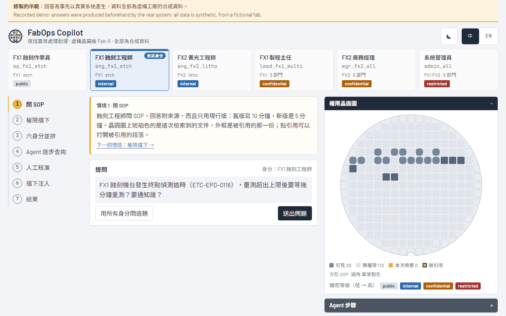
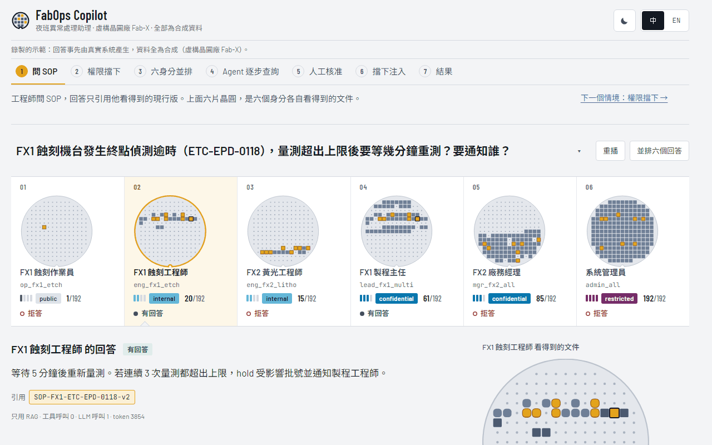
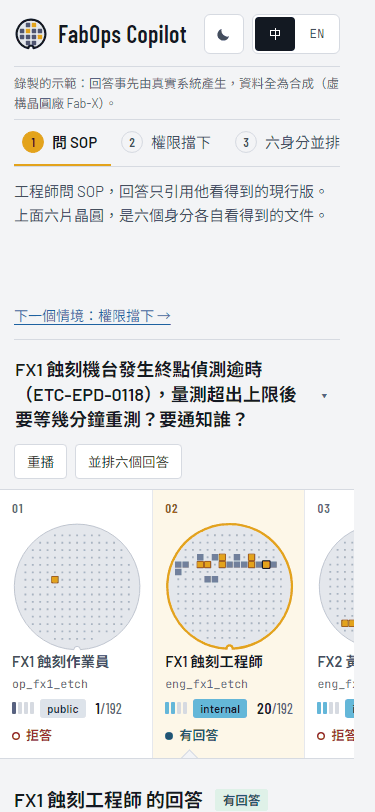

# 設計案例：從 v8 到 v9，我怎麼指揮 AI 做設計並驗收

[English](case-study-design-lab.en.md) · 現行版：<https://colin-lai-dev.github.io/fabops-copilot/> · 舊版 v8：<https://colin-lai-dev.github.io/fabops-copilot/v8/>

## 1. 背景

這個 demo 要在 30 秒內讓面試官看懂三件事：

1. 同一個問題，權限不同就得到不同答案；權限在檢索之前就過濾。
2. Agent 一步一步用唯讀工具查資料，最後只能提出建議，要由有權限的人核准，全程留 audit log。
3. 所有回答都是真實系統錄製，資料是合成的，數字可以重現。

## 2. 兩種指揮方式

- **v1–v8：逐條提需求。** 我每一輪列出具體要改的事，例如把機密等級改成色塊（`79d66c9`）、移除自我解釋的備註（`98c236a`、`b70da04`）、修掉切換語言時的版面跳動（`e3caca4`）。實作由 AI 模型〔模型名稱 A，待作者填入〕完成。
- **v9：給一份開放式設計需求。** 我只寫目標、紅線和品質底線（全文見附錄），由 AI 模型〔模型名稱 B，待作者填入〕自己審查舊版、提出三個方向、選一個做到底。

## 3. 我設定的框架

- **檢驗標準**：每個設計決定都要回答「它讓那三件事更清楚了嗎」。
- **紅線**：錄製的資料不可手改；不得加入任何非錄製的回答或數字；權限呈現必須正確（看不到的文件不顯示任何屬性）；不呼叫付費 API；前端 bundle 增加不得超過 150 KB。
- **品質底線**：1280／1024／375 三種寬度都可用；亮暗主題文字對比 WCAG AA；切換身分、步驟、語言時主要區塊零位移（用腳本量）；行動版 Lighthouse 各項 ≥ 90。
- **流程**：至少三輪「截圖 → 挑出最弱的三處 → 修」；最後一輪刪掉一個多餘的元素。
- **平行預覽**：新設計先部署在獨立的 `/lab/` 路徑，正式站完全不動；我看過才決定要不要取代。

## 4. 結果

v9 的概念是一句話：**六個身分就是一盒晶圓裡的六片；同一個問題照下去，六片亮起來的地方不一樣。**
它把 v8 的身分卡、權限晶圓圖、六身分並排三個元件合成一排，換身分不換題目。

| v8 首屏（1280） | v9 首屏（1280） | v9 首屏（375） |
| --- | --- | --- |
|  |  |  |

| 項目 | v8 | v9 | 量測方式 |
| --- | --- | --- | --- |
| Lighthouse 效能（行動版） | 80／89／82 | 98／97／98 | Lighthouse 13.6，線上網址各跑 3 次（2026-11-13）；v8 量的是 `/v8/` |
| 首次內容繪製 FCP | 2.1–2.5 s | 1.5–1.8 s | 同上 3 次的範圍 |
| 累計版面位移 CLS | 0–0.262 | 0–0.043 | 同上 3 次的範圍 |
| CSS 大小（未壓縮） | 444 KB | 42 KB | 線上檔案位元組數；差異主要來自不再下載中文字型 |
| JS 大小（未壓縮） | 209 KB | 204 KB | 同上 |
| 不點任何東西就看得到權限差異 | 否（要到第 3 步或按鈕） | 是（首屏） | 看上面兩張首屏截圖 |
| 權限呈現檢查 | — | 66 個畫面全過 | `web/scripts/review-lab.mjs`：11 題 × 6 身分，核對鎖住的文件數與引用文件；3 種寬度 × 亮暗 |
| 互動造成的主要區塊位移 | — | 0 px | `web/scripts/measure-shift.mjs`：20 種互動 × 3 種寬度 |

## 5. 我的驗收與否決

- **否決：模型拿掉了機密等級的顏色。** 為了讓顏色只代表「檢索、結果、agent」，v9 初版把四個等級改成單色刻度（`8edcb9c`）。我要求改回彩色，但必須避開狀態色，色弱也要能分辨。實作時第一組配色裡的藍和 agent 的紫在色弱模擬下太接近，被檢查腳本擋下；最後採用灰 → 天藍 → 靛藍 → 梅紫（`d5a1160`）。等級色與狀態色的最小色差 ΔE（CIE76，門檻 20）：亮色主題 44.8／27.1／26.1，暗色 28.9／22.1／22.9（依序為一般色覺、protanopia、deuteranopia 模擬；`web/scripts/palette_check.py`）。
- **抓到：核准後 audit log 消失（v5）。** 自檢只驗「紀錄出現過」，沒驗「之後還在」。原因是整頁截圖或把視窗拉過 760px 時，核准區在兩欄之間搬移而被重建，狀態遺失。修正後自檢加了兩個持續性斷言（`b17209f`）。
- **抓到：點開選單時畫面晃動（v9）。** 我在實際操作時看到，自檢沒測到，因為只有視窗較矮時才發生。原因是選單為了讓目前選項可見而呼叫 `scrollIntoView`，它連整個頁面一起捲（1280×620 捲 74 px，手機 199 px）。改成只捲清單本身，並把選單的開、移動、關、選取加入位移量測（`ebfb2e6`）。
- **抓到：步驟列間距不均（v6）。** 為了讓切換語言時零位移，每一步預留了兩種語言中較高的高度，結果某幾步下方多出空白、編號和文字沒對齊（`e3caca4`）。改成固定列高、縮短英文步驟名（`b4ddba5`）。
- **採用，但保留舊版。** v9 取代正式站；v8 從它的 tag 原樣建置到 `/v8/`，兩種做法可以並排比較（`7d1cbdd`）。

## 6. 限制

- 這不是公平的模型比較：v8 從未拿過同一份開放式需求，兩個階段的指揮方式也不同，不能據此推論哪個模型比較好。
- 所有資料是合成的（虛構晶圓廠 Fab-X）。
- 設計好壞有主觀成分；上面的量測只涵蓋可以量化的部分。
- Lighthouse 分數每次會波動，所以列出 3 次的個別結果與範圍，而不是單一數字。

---

## 附錄：v9 的設計需求全文

以下是交給模型的需求，只刪去內部路徑與個人資訊，其餘未改。

> ### 目的
> 作者已把 `site-v8` 定版，正式網站維持 v8 不動。這一輪是一個**實驗**：在不受「小幅修改」限制的情況下，
> 看你能把這個 demo 的設計打磨到什麼程度。請拿出你最好的設計判斷力，不是把清單做完，而是做出一個讓人看了會記得的作品。
> 成品放在獨立的 `/lab/` 路徑給作者比較；他滿意才取代正式版，不滿意就整個丟掉，正式版完全不受影響。
>
> ### 0. 版本保護與部署方式（先做，不可跳過）
> 1. 在目前 main 打 tag `site-v8-final`（等同 site-v8，作為「一鍵回到定版」的錨點），push tag。
> 2. 在 branch `design-lab` 上開發。**不得合併到 main**。
> 3. 修改 `.github/workflows/pages.yml`（這個改動本身要合併到 main，是唯一允許進 main 的變更）：
>    - 照舊以 main 建置正式站到 `web/dist`。
>    - 另外 checkout `design-lab` 分支（若存在），以 base `/fabops-copilot/lab/` 建置，輸出放進 `web/dist/lab/`，一起部署。
>    - `design-lab` 分支 push 時也觸發部署（建置來源仍是 main＋design-lab）。
>    - lab 頁面加 `<meta name="robots" content="noindex">`，並在頁首橫幅註明「設計實驗版」，附一個回到正式版的連結。
>    - 部署後確認：正式站與 v8 完全相同，lab 站可開。
> 4. 之後的決定（由作者做，不是你）：採用 → 把 design-lab 合併 main、tag `site-v9`、移除 lab 建置；放棄 → 刪除 lab 建置步驟即可，main 從未被動過。
>
> ### 1. 先理解，再設計
> - 讀 demo 腳本、README、目前網站的程式與 v8 的截圖。若環境有設計相關的 skill，先載入並遵守。
> - 以第一次看到這個網站的面試官身分，用 1280 與 375、亮與暗把整個流程走一遍並截圖。寫下你的「設計審查」：
>   哪裡第一眼看不懂、哪裡視覺層級不清、哪裡太平、哪裡太滿、哪裡像模板。至少 10 點，具體到元件。
> - 這個網站要在 30 秒內讓面試官理解三件事：
>   1. 同一個問題，權限不同就得到不同答案（權限在檢索之前就過濾）。
>   2. agent 一步一步用唯讀工具查資料，最後只能提出建議，必須由有權限的人核准，全程留 audit log。
>   3. 所有回答都是真實系統錄製，資料是合成的，數字可以重現。
>
>   設計的每一個決定都要能回答「它讓這三件事更清楚了嗎」。
>
> ### 2. 提出方向，選一個做到底
> - 提出 3 個明顯不同的設計方向，每個附：一句話概念、色彩（4–6 個具名 hex）、字體與層級、版面草圖（ASCII 即可）、
>   「這個方向最難忘的那一個元素」。方向要從晶圓廠、夜班 MES 主控台、無塵室、晶圓檢測等題材本身找靈感，
>   避免一看就是 AI 生成的模板感（米白底配襯線字、黑底配螢光綠、到處都是一樣圓角加陰影的卡片、每個標題上面都有全大寫小標）。
> - 自己選一個，寫下選擇理由，然後全力實作。把大膽留給一個地方：讓一個元素成為記憶點，其他地方安靜、有紀律。
>
> ### 3. 可以動與不能動
> **可以大幅改動**：版面結構、資訊架構與閱讀順序、字體、色彩系統、間距與格線、元件外觀、互動與動畫、首屏呈現方式、
> 晶圓圖的視覺、六身分並排的呈現、agent 時間軸的呈現、空狀態與錯誤狀態、文案用詞（更短、更清楚）。
>
> **功能必須全部保留且可用**：7 個導覽情境、六身分並排（10 題）、權限晶圓圖與三段動畫、引用側欄、agent 逐步時間軸、
> 核准三種結果與 audit log、攔下注入與對照組、結果圖表、中英切換、亮暗主題、深連結、鍵盤操作。
>
> **絕對不能動**（違反就停下回報）：
> - 錄製的回答與結果資料（`scenes.json`、`results.json`）不得手改；不得加入任何非錄製的回答、數字或假資料。
> - 權限呈現必須正確：鎖住的文件不顯示任何屬性或內文；側欄只顯示該身分看得到的段落。
> - 不得出現任何真實公司、廠區、機台、製程或內部系統名稱或商標。
> - 不得新增後端、不得呼叫任何付費 API。新增前端依賴要說明理由，總 bundle（不含字型）增加超過 150 KB 先停下回報。
> - 不讀 .env、不 force push、不改寫歷史、不刪資料。
>
> ### 4. 品質底線（不必宣告，但必須做到）
> - 1280、1024、375 三種寬度都好看且可用；無水平捲動。
> - 亮暗主題文字對比 WCAG AA；鍵盤 focus 清楚；`prefers-reduced-motion` 尊重。
> - 切換身分、步驟、語言時，主要區塊零位移（沿用先前的量測腳本）；核准後 audit log 持續顯示（沿用斷言）。
> - 動畫：自動播放的只能有一個精心編排的時刻；其他動畫只回應使用者操作。
> - Lighthouse（行動版）效能、無障礙、最佳實務都 ≥ 90，數字寫進回報。
>
> ### 5. 自我批評迴圈（至少三輪）
> 每一輪：截圖 → 以面試官與資深設計師兩種眼光挑出最弱的三處 → 修 → 再截圖。
> 最後一輪做「出門前拿掉一件配件」：刪掉一個你覺得多餘的裝飾或元素。三輪的截圖與挑出的問題都保留並寫進回報。
>
> ### 6. 交付
> - `design-lab` 分支，每個有意義的改動獨立 commit；lab 站上線可開。
> - v8 與 lab 的同畫面對照截圖（首屏、六身分、agent、核准、注入、結果；1280 與 375；亮與暗）。
> - 回報：
>   1. 設計審查的重點（你認為 v8 最大的問題是什麼）。
>   2. 三個方向與你選擇的理由。
>   3. 改了什麼、為什麼（依「讓三件事更清楚」組織，不是流水帳）。
>   4. 你刻意**沒有**做的事與理由。
>   5. 品質底線的量測結果（位移、對比、Lighthouse、bundle 大小）。
>   6. 你自己對成品的誠實評價：最滿意的一處、最不確定的一處。
>   7. 使用的模型名稱。
